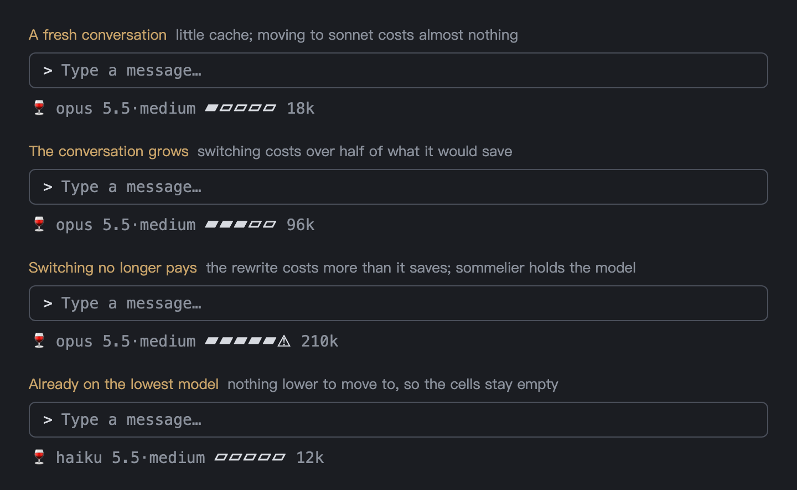

<p align="center">
  
</p>

[English](README.md) | [繁體中文](README.zh-TW.md) | [简体中文](README.zh-CN.md) | [日本語](README.ja.md) | 한국어

# sommelier: Claude Code용 자동 모델 라우팅 (Claude Code mod)

**Claude Code mods**(mods API의 `turn.step`)를 기반으로 만든 **Claude Code 플러그인**으로, 작업마다 모델과 effort를 자동으로 고릅니다. 간단한 조회는 **Claude Haiku**에, 요구 사항이 명확한 변경은 **Claude Sonnet**에, 조사나 설계는 **Claude Opus**에 맡기며, 각 요청의 분류는 **TypeSafe Jev**가 담당합니다. 품질을 포기하지 않으면서 Claude Code 사용량을 아낄 수 있습니다.

소믈리에가 요리마다 와인을 고르듯, sommelier는 새 요청이 들어올 때마다 [TypeSafe Jev](https://docs.typesafe.ai)(확률을 반환하는 분류 API)에 세 가지를 묻습니다. **얼마나 많은 추론이 필요한지**, **새 작업을 시작하는 요청인지**, **고위험 작업인지**입니다. 그리고 그 답을 설정 가능한 단계표에 대응시킵니다.

| 추론 깊이 | 기본 단계 | 예시 |
|---|---|---|
| L0 조회 또는 기계적인 수정 | haiku · medium | "package.json의 버전을 확인해 줘" |
| L1 목표와 방법이 명확함 | sonnet · medium | "parseDate에 timezone 매개변수를 추가해 줘" |
| L2 조사나 트레이드오프 검토가 필요함 | `base` (opus · medium) | "로그인이 가끔 401을 반환하는데, 원인을 찾아 줘" |
| L3 범위가 열려 있어 오랜 숙고가 필요함 | opus · high | "멀티테넌트 권한 아키텍처를 설계해 줘" |

**왜 매 턴마다 모델을 바꾸지 않을까요?** 모델마다 프롬프트 캐시가 따로 있기 때문에, 모델을 바꾸면 대화 전체를 캐시에 다시 써야 하고 이것도 사용량을 소모합니다. sommelier의 원칙은 **업그레이드는 언제든지, 다운그레이드는 이득일 때만**입니다. 즉 새 작업일 때, 그리고 전환 비용이 절약되는 양보다 적을 때만 다운그레이드합니다.

## 빠른 시작

```bash
claude plugin marketplace add wide3751/sommelier
claude plugin install sommelier@sommelier
# 다음 줄을 실행한 뒤 TypeSafe API 키를 붙여 넣고 Enter를 누릅니다(키는 표시되지 않습니다)
read -rs TYPESAFE_API_KEY
# 키를 macOS 키체인에 저장합니다
printf '{"typesafe_api_key":"%s"}' "$TYPESAFE_API_KEY" | claude plugin configure sommelier@sommelier --values-stdin
```

API 키는 [TypeSafe 콘솔](https://console.typesafe.ai/keys)에서 만듭니다. `~/.zshrc`에 이미 `TYPESAFE_API_KEY`가 설정되어 있다면 `read` 줄은 건너뛰어도 됩니다.

Claude Code를 다시 시작하면 sommelier가 켜지며, 따로 설정할 것은 없습니다.

1. 요청을 보냅니다. 예: "parseDate에 timezone 매개변수를 추가해 줘"
2. 스피너에 선택된 단계가 표시됩니다. 예: `sonnet·medium L1 · 新話題，降級` (새 주제, 다운그레이드)

끄려면 `/somm off`를 실행합니다. 자세한 내용은 [설치](#설치)와 [사용법](#사용법)을 참고하세요.

## AI 에이전트로 설치하기

먼저 TypeSafe API 키를 준비합니다. 키를 에이전트에게 건네지 말고, 직접 환경 변수로 설정하세요.

1. [TypeSafe 콘솔](https://console.typesafe.ai/keys)에서 API 키를 만듭니다
2. 터미널에서 다음을 실행해 `~/.zshrc`에 추가합니다. `your-api-key`는 자신의 키로 바꿉니다.

   ```bash
   echo 'export TYPESAFE_API_KEY="your-api-key"' >> ~/.zshrc
   ```

3. 새 변수가 반영되도록 터미널과 Claude Code를 다시 시작합니다

그런 다음 Claude Code나 다른 코딩 에이전트에 다음 내용을 붙여 넣습니다.

> Install sommelier by following https://github.com/wide3751/sommelier/blob/main/INSTALL-AGENT.md

## 요구 사항

- Claude Code **v2.1.287 이상**(터미널) 또는 데스크톱 앱에 포함된 **v2.1.286 이상**(Code 탭에서 `/status`를 입력해 확인)
- TypeSafe API 키([TypeSafe 콘솔](https://console.typesafe.ai/keys)에서 생성)

## 설치

1. 마켓플레이스를 추가하고 설치합니다. 두 가지 방법이 있으며, **GitHub를 권장합니다**.

   **방법 A: GitHub에서 설치(권장)** — 프로젝트를 내려받을 필요가 없습니다.

```bash
claude plugin marketplace add wide3751/sommelier
claude plugin install sommelier@sommelier
```

   나중에 새 버전으로 업데이트하려면 마켓플레이스를 업데이트한 뒤 플러그인을 업데이트하고 Claude Code를 다시 시작합니다(이미 설치된 플러그인에 `install`을 다시 실행해도 업그레이드되지 않습니다).

```bash
claude plugin marketplace update sommelier
claude plugin update sommelier@sommelier
```

   **방법 B: 로컬 폴더에서 설치** — 프로젝트를 클론해 두었고 직접 수정한 내용을 설치하고 싶을 때 사용합니다.

```bash
git clone https://github.com/wide3751/sommelier.git ~/Projects/sommelier
claude plugin marketplace add ~/Projects/sommelier
claude plugin install sommelier@sommelier
```

2. TypeSafe API 키를 설정합니다(macOS 키체인에 저장됩니다). 터미널에서는 세션 안에서 `/plugin configure sommelier@sommelier`를 실행하면 됩니다. 데스크톱 앱의 Code 탭에는 입력란이 표시되지 않으므로 대신 터미널에서 다음을 실행합니다.

```bash
# 다음 줄을 실행한 뒤 TypeSafe API 키를 붙여 넣고 Enter를 누릅니다(키는 표시되지 않습니다)
read -rs TYPESAFE_API_KEY
# 키를 macOS 키체인에 저장합니다
printf '{"typesafe_api_key":"%s"}' "$TYPESAFE_API_KEY" | claude plugin configure sommelier@sommelier --values-stdin
```

   명령어에 키를 직접 입력하지 않습니다. `read`는 이 터미널의 `TYPESAFE_API_KEY` 변수에 키를 붙여 넣기를 기다리고, 다음 줄이 그 키를 키체인에 저장하므로 키가 셸 기록에 남지 않습니다. `~/.zshrc`에 이미 `TYPESAFE_API_KEY`가 설정되어 있다면 `read` 줄은 건너뛰어도 되지만, 현재 셸에서 그 변수가 보이는지 확인하세요(예: 새 터미널 창을 엽니다). `TYPESAFE_API_KEY` 환경 변수만으로 대신할 수도 있지만, Dock에서 실행한 데스크톱 앱은 `~/.zshrc`를 읽지 않습니다.

### Windows에서 설치하기

1단계(마켓플레이스 추가와 설치)의 명령어는 PowerShell에서 그대로 동작합니다. 로컬 폴더 방식이라면 Windows 경로를 사용합니다. 예: `claude plugin marketplace add C:\Projects\sommelier`.

2단계의 `read -rs`는 PowerShell에 없습니다. 대신 다음을 실행합니다(Windows PowerShell 5.1과 PowerShell 7에서 동작합니다).

```powershell
# 다음 줄을 실행한 뒤 TypeSafe API 키를 붙여 넣고 Enter를 누릅니다(입력 내용은 표시되지 않습니다)
$s = Read-Host "TypeSafe API key" -AsSecureString
$key = [System.Net.NetworkCredential]::new("", $s).Password
# Claude Code에 넘겨 플러그인 설정으로 저장합니다
'{"typesafe_api_key":"' + $key + '"}' | claude plugin configure sommelier@sommelier --values-stdin
Remove-Variable key, s
```

키체인은 macOS 전용이므로, Windows에서는 키가 Claude Code의 플러그인 설정에 보관됩니다. 대신 환경 변수를 대체 수단으로 쓰려면 사용자 변수로 영구 설정한 뒤(`your-api-key`는 자신의 키로 바꿉니다) 터미널과 Claude Code를 다시 엽니다.

```powershell
[Environment]::SetEnvironmentVariable("TYPESAFE_API_KEY", "your-api-key", "User")
```

3. Claude Code를 다시 시작하고 `/somm status`를 실행해 API 키가 설정되었다고(「API key 已設定」) 표시되는지 확인합니다.

## 사용법

설치하면 기본적으로 켜져 있으므로 `/somm on`을 실행할 필요가 없습니다. 요청을 처음으로 TypeSafe에 보내기 전에 sommelier가 동의를 구합니다. 동의하면 다시 묻지 않고, 거절하면 그 턴은 세션의 모델을 유지하며 sommelier가 꺼집니다.

| 명령어 | 설명 |
|---|---|
| `/somm on` | 다시 켭니다. 이후 보내는 모든 프롬프트를 Jev가 판정합니다(짧은 답장은 제외) |
| `/somm off` | 끄고 세션 자체의 모델과 effort를 유지합니다 |
| `/somm off --project` | 현재 프로젝트에서만 꺼서 그 프로젝트의 내용은 전송하지 않습니다. `/somm on --project`로 되돌립니다 |
| `/somm status` | 켜짐/꺼짐, 이 프로젝트가 꺼져 있는지, API 키 설정 여부, 이 세션의 단계를 표시합니다 |
| `/somm log [n]` | 최근 n건의 라우팅 기록: 선택된 단계, Jev의 확률, 캐시 읽기와 쓰기 |
| `/somm events` | 최근 20건의 상태 이벤트(모델 전환, 대화 초기화 또는 재개, 프롬프트 출처, 각 턴의 라우팅). sommelier가 왜 전환하지 않았는지 알아볼 때 사용합니다 |
| `/somm config` | 설정 목록을 표시합니다. `/somm config <name> <value>`로 항목 하나를 바꾸며, 즉시 적용됩니다 |

**설정** (`/somm config <name> <value>`):

| 이름 | 기본값 | 값 |
|---|---|---|
| `enabled` | on | on／off. `/somm on`, `/somm off`와 같습니다 |
| `base` | opus | 조사나 비교가 필요한 요청(L2)의 단계이자, 고위험 요청에 쓰는 최저 모델입니다. `haiku`／`sonnet`／`opus`, effort를 붙일 수도 있습니다. 예: `opus:high` |
| `profile` | balanced | `saver`(opus를 덜 쓰고, 새 주제를 더 빨리 판정), `balanced`, `quality`(sonnet과 opus를 더 빨리 쓰고, haiku는 15k 미만 대화에서만 사용) |
| `allowed` | haiku-opus | sommelier가 고를 수 있는 모델. 예: `sonnet-opus`이면 haiku를 쓰지 않습니다. `somm:` 오버라이드에는 제한이 적용되지 않습니다 |
| `spinner` | on | Claude가 작업하는 동안 스피너에 이번 턴의 라우팅을 표시할지 여부 |
| `cache` | on | 상태 줄에 캐시 게이지를 표시할지 여부. `off`이면 모델과 effort만 표시합니다 |
| `notify` | important | 중요한 알림: 캐시를 다시 쓰게 되는 오버라이드나 다운그레이드, Jev 3회 연속 실패, API 키 없음(한 번만 표시). 턴마다 최대 하나이며, 10초 안에 여러 개가 생기면 10초가 지난 뒤 가장 최근 것만 표시합니다. `off`이면 아무것도 표시하지 않습니다 |
| `skills` | off | 스킬 힌트 켜기/끄기(베타, 기본값은 꺼짐). `on`이면 켜고, `off`이면 스킬 힌트만 멈추며 모델 라우팅은 계속됩니다 |
| `skills-allow` | (전체) | 이 스킬들만 후보로 삼습니다. 쉼표로 구분하며 `/skills`에 표시되는 이름 그대로 씁니다. 예: `mattpocock-skills:tdd,grilling`. `none`이면 비웁니다 |
| `skills-exclude` | (없음) | 이 스킬들은 절대 힌트로 제시하지 않습니다. 쓰는 방식은 같으며, 두 목록에 모두 있는 스킬은 제외됩니다 |

켜져 있으면 프롬프트 아래의 상태 줄에 실제로 응답한 모델, 그 버전과 effort가 표시되고 그 뒤에 캐시 게이지가 이어집니다. 예: `🍷 opus 5.5·medium ▰▰▱▱▱ 95k`. 그 옆에 Claude Code가 표시하는 모델은 세션 자체의 모델입니다.

**캐시 게이지**: 숫자는 현재 모델에 쌓인 캐시의 양입니다. 5칸은 `allowed` 범위에서 한 단계 낮은 모델로 내려갈 때의 전환 비용(캐시를 다시 쓰는 비용)이 그 전환으로 절약될 것으로 예상되는 사용량에서 차지하는 비율을 나타내며, 한 칸이 20%입니다. 칸이 많이 찰수록 하위 모델로의 전환이 이득이 적습니다. 모든 칸이 차고 `⚠`가 붙으면(예: `▰▰▰▰▰⚠ 243k`) 전환 비용이 절약량보다 크다는 뜻이므로 sommelier는 다운그레이드를 막으며, 직접 전환하는 것도 권장하지 않습니다. 캐시가 만료되었거나 이미 허용된 최저 모델을 쓰고 있으면 칸이 비어 있습니다. 상태 줄에는 색을 입힐 수 없어서, 꽉 찬 칸과 `⚠`가 빨간색 경고를 대신합니다. 줄이 복잡하게 느껴지면 `/somm config cache off`로 끌 수 있습니다.



<sub>예시 그림: 새 대화, 조금 긴 대화, 더 이상 전환이 이득이 아닌 경우, 이미 최저 모델인 경우.</sub>

다른 플러그인이 이미 `/somm`을 사용하고 있으면 명령어는 `/sommelier`로 대체됩니다.

**모델 직접 고르기(오버라이드)**: 프롬프트를 `somm:opus`, `somm:sonnet` 또는 `somm:haiku`(대소문자 무관)로 시작하면, 그 요청은 Jev에 묻지 않고 해당 모델(medium effort)을 사용합니다. 접두사는 모델이 프롬프트를 보기 전에 제거됩니다. Jev가 새 주제로 판정하거나, `/clear`를 실행하거나, `/model`로 전환할 때까지 그 주제의 나머지 동안 같은 모델이 유지됩니다. 접두사 뒤에 아무것도 없으면 아무것도 보내지 않고 이후 요청에 쓸 모델만 정합니다. 전환으로 캐시를 다시 쓰게 되면 몇 토큰인지, 대략 비용이 얼마인지 알림으로 알려 줍니다.

**각 요청을 판정하는 방식:**
- **업그레이드**: 요청에 더 강한 모델이나 더 높은 effort가 필요하면 언제든 올라갑니다
- **고위험**: 데이터를 삭제하거나 덮어쓰는 요청, 프로덕션이나 권한을 변경하는 요청은 최소 base(기본값 opus)로 올라가며, 그 요청에 한해 high effort를 사용합니다
- **깊은 사고 요청**: 프롬프트에 `ultrathink`, 「仔細想」(자세히 생각해) 또는 「深入想」(깊이 생각해)가 포함되어 있으면(코드 안은 제외) Jev에 묻지 않고 바로 opus · high로 갑니다
- **다운그레이드**: 새 주제일 때만, 그리고 예상 절약량이 캐시를 다시 쓰는 비용보다 클 때만 내려갑니다. 그렇지 않으면 그 요청은 현재 모델을 유지합니다
- **유지**: 같은 주제에서 판정이 더 낮게 나온 경우, 짧은 답장("ok", "계속"; Jev에 보내지 않음), Jev가 시간 초과되거나 오류를 낸 경우에는 현재 모델을 유지합니다
- **긴 대화에는 haiku를 쓰지 않음**: 30k 토큰을 넘는 대화는 haiku로 내려가지 않으며, 이미 haiku를 쓰고 있는 대화가 그 크기를 넘으면 sonnet으로 올라갑니다

**스킬 힌트**(베타, 기본값은 꺼짐. `/somm config skills on`으로 켭니다): 모델과 함께 Jev가 요청에 스킬이 필요한지, 어떤 스킬이 가장 잘 맞는지 판정합니다. 충분히 확신할 때("스킬 필요" ≥ 0.30이고 1순위 스킬 ≥ 0.5) sommelier는 프롬프트 옆에 Claude를 위한 메모를 덧붙여, 요청이 그 스킬에 맞을 수 있다고(틀릴 수도 있다고) 알립니다. 어디까지나 제안일 뿐이어서, 맞지 않으면 Claude는 무시하며 모델은 절대 바꾸지 않습니다. 후보는 이 세션에서 Claude가 직접 호출할 수 있고 설명이 있는 스킬이며, `skills-allow`와 `skills-exclude`로 좁힙니다. 같은 스킬은 주제당 한 번만 힌트로 제시되며, 새 주제가 되거나 `/clear`한 뒤에야 다시 제시됩니다. 힌트는 스피너에 `💡tdd`처럼 표시되고, `/somm log`에 Claude가 그 힌트를 받아들였는지가 기록됩니다. 스킬 힌트가 켜져 있으면 힌트를 함께 보낼 수 있도록, 프롬프트를 보낸 뒤 Jev를 기다립니다(최대 1.5초).

**sommelier가 모델을 바꾸지 않는 경우:**
- 꺼져 있거나 현재 프로젝트에서 꺼져 있을 때
- 첫 전송 전의 동의 질문에 동의하지 않았을 때
- 세션의 첫 요청에서 Jev가 실패했거나 API 키가 설정되지 않았을 때(이후의 실패는 현재 모델을 유지)
- 요청이 서브에이전트에서 온 것일 때

### 예시

플러그인의 메시지는 현재 중국어로 되어 있으며, 번역은 주석에 적었습니다.

켜 둔 상태에서 "parseDate에 timezone 매개변수를 추가해 줘"를 보내면, Jev가 L1으로 판정해 세션의 opus가 sonnet으로 내려가고 스피너에 다음과 같이 표시됩니다.

```
sonnet·medium L1 · 新話題，降級   # 새 주제, 다운그레이드
```

"ok"라고 답하면, 짧은 답장은 Jev에 보내지 않으므로 같은 단계를 유지합니다.

```
sonnet·medium · 沿用             # 유지
```

이어서 "멀티테넌트 권한 아키텍처를 설계해 줘"라고 요청하면, Jev가 L3로 판정해 올라갑니다.

```
opus·high L3 · 升級              # 업그레이드
```

`/somm status`:

```
sommelier 開啟｜API key 已設定｜本 session 檔位 sonnet·medium
# sommelier 켜짐 | API 키 설정됨 | 이 세션의 단계 sonnet·medium
```

`/somm log 3` — P는 L0/L1/L2/L3에 대한 Jev의 확률입니다. 판정에 실패한 턴은 `session`으로 표시되고 원래 모델을 유지합니다. "回答"(응답)은 실제로 응답한 모델이고, 대괄호 안은 세션 ID의 앞 6자입니다.

```
sonnet·medium · 回答 sonnet · downgrade P=0.05/0.90/0.05/0.00 jev 820ms cache read 0 write 18342 [a1b2c3]
sonnet·medium · 回答 sonnet · continuation cache read 18342 write 1204 [a1b2c3]
opus·high · 回答 opus · upgrade P=0.02/0.08/0.20/0.70 jev 410ms cache read 0 write 21530 [a1b2c3]
```

## 제한 사항

- **수동 `/model`**: `/model`로 모델을 한 번 바꾸면, `/model`에서 Default를 고를 때까지 sommelier는 모델 변경을 멈추며 `/clear`나 재개 후에도 마찬가지입니다. Claude Code가 스스로 다른 모델로 폴백한 경우에도, 직접 `/model`을 실행할 때까지 sommelier는 관여하지 않습니다.
- **판정하지 않는 턴**: 알림, 예약 작업, 다른 세션이나 다른 플러그인에서 온 메시지, 그리고 슬래시 명령어는 현재 모델을 유지하며 Jev에 보내지 않습니다. 세션 모델이 Opus, Sonnet, Haiku 5.5가 아니면(예: `[1m]` 변형이나 이전 버전) sommelier는 아무것도 바꾸지 않습니다.
- **이득이 없는 다운그레이드는 하지 않음**: 모델마다 캐시가 따로 있으므로, 전환하면 대화를 새 모델의 캐시에 써야 합니다. sommelier는 각 모델의 캐시가 어디까지 닿아 있는지 추적합니다. 한 번도 쓰지 않았거나 캐시 TTL이 지나도록 쓰지 않은 모델은 대화 전체를 다시 써야 하고, 조금 전에 쓴 모델로 돌아가면 새로 생긴 부분만 추가하며, `/clear`, compact, 재개 뒤에는 시스템 프롬프트만 캐시에 남아 있습니다. 다운그레이드하기 전에 그 재작성 비용을 더 저렴한 모델로 약 3턴 동안 절약할 양과 비교합니다. 이득이 없으면 그 요청은 현재 모델을 유지하고, 다음 새 주제에서 다시 따져 봅니다. 업그레이드에는 영향이 없습니다. 가격은 `hooks/decide.ts`에 있는 정가를 사용합니다.
- **모델 선택기에는 세션 모델이 표시됨**: sommelier는 보내는 요청마다 모델을 바꿀 뿐 세션 자체의 모델은 바꾸지 않으므로, `/model`과 데스크톱 모델 선택기에는 원래 모델이 계속 표시됩니다. 상태 줄의 🍷 뒤에 있는 모델이 실제로 응답한 모델입니다.
- **판정에는 시간이 걸림**: 요청마다 판정을 최대 1.5초 기다립니다(오프라인 평가 p95 약 0.4초). 짧은 답장은 보내지 않으므로 기다리지 않습니다.
- **데스크톱 앱**: Code 탭에서는 `/plugin configure`로 API 키를 입력할 수 없으니, 대신 터미널에서 설정하세요(설치 참고).

## 문제 해결

| 증상 | 해결 방법 |
|---|---|
| `/somm status`에 API 키가 설정되지 않았다고(「API key 未設定」) 표시됨 | 설치의 2단계를 다시 진행합니다. 환경 변수만 사용한다면 Claude Code를 실행하는 셸에서 `TYPESAFE_API_KEY`가 보이는지 확인하세요. Dock에서 실행한 데스크톱 앱은 `~/.zshrc`를 읽지 않습니다 |
| 스피너에 `Jev 失敗`(Jev 실패)가 표시됨 | `/somm log`에서 원인을 확인합니다. `no_key`는 키 없음, `timeout`은 1.5초 초과, `http_401` 등은 API 오류, `fetch_failed`는 TypeSafe에 연결할 수 없음을 뜻합니다. 그 턴은 현재 모델을 유지하며, 세션의 첫 요청이 실패하면 세션 자체의 모델을 사용합니다 |
| `/somm`이 없음 | 다른 플러그인이 사용하고 있습니다. `/sommelier`를 사용하세요 |
| 코드를 수정해도 반영되지 않음 | 설치된 사본은 `plugin.json`의 `version` 기준으로 캐시됩니다. 버전을 올리고 `claude plugin update sommelier@sommelier`를 실행한 뒤 다시 시작하거나, 개발 중에는 `--plugin-dir`를 사용하세요 |

## 개인정보와 데이터

sommelier는 설치하면 기본적으로 켜져 있으며, 켜져 있는 동안 판정을 위해 TypeSafe에 데이터를 보냅니다. 처음 보내기 전에 동의를 구하며, `/somm off`를 실행하면 아무것도 보내지 않습니다.

- **언제**: 새 요청마다 보냅니다. 짧은 답장(공백과 문장 부호를 뺀 뒤 8자 이하, 예: "ok", "계속")은 보내지 않습니다
- **보내는 내용**: 현재 요청(최대 2,000자)과 직전 3턴의 텍스트(각 최대 500자, 끝부분을 남김). 스킬 힌트가 켜져 있으면 후보 스킬의 이름과 설명(각 최대 300자)도 보냅니다. 첫 사용 시의 질문에는 스킬이 포함되지 않으며, 스킬 힌트를 켠 뒤 스킬 데이터를 처음 보내기 전에 따로 묻습니다. 거절하면 스킬 힌트만 꺼집니다
- **보내기 전 마스킹**: 흔한 비밀 정보 형식은 `[REDACTED]`로 바뀝니다. `sk-`, `AKIA`, `ghp_`, `xoxb-`/`xoxp-`, `AIza`, `Bearer`, `password=`, JWT, 개인 키 블록, 32자 이상의 16진수 문자열이 해당됩니다
- **보내지 않는 내용**: 파일 내용, 도구 호출과 도구 출력, 서브에이전트의 요청, `/somm off --project`로 끈 프로젝트
- **로컬 기록**: `/somm log` 기록에는 단계, Jev의 확률, 지연 시간, 캐시 읽기와 쓰기, 힌트로 제시한 스킬과 그 수용 여부, 프롬프트의 앞 40자(마스킹됨)가 저장됩니다. 꺼 둔 프로젝트는 프롬프트를 저장하지 않습니다. 플러그인을 업데이트한 뒤에도 실행 중인 세션이 이어지도록, 세션별 라우팅 상태(현재 단계, 캐시 장부, 오버라이드 잠금 등, 프롬프트는 포함하지 않음)도 로컬에 보관하며 최근 20개 세션만 유지합니다
- **API 키**: macOS 키체인(`/plugin configure`)에 저장하거나 `TYPESAFE_API_KEY` 환경 변수에서 읽습니다

## 기여하기

개발 환경 설정, 오프라인 평가, 프로젝트 구조는 [CONTRIBUTING.md](CONTRIBUTING.md)(중국어)를 참고하세요.

## 문서

- [GLOSSARY.md](GLOSSARY.md): 용어집(단계, 새 작업, 캐시 장부…)

## 라이선스

[MIT](LICENSE)
