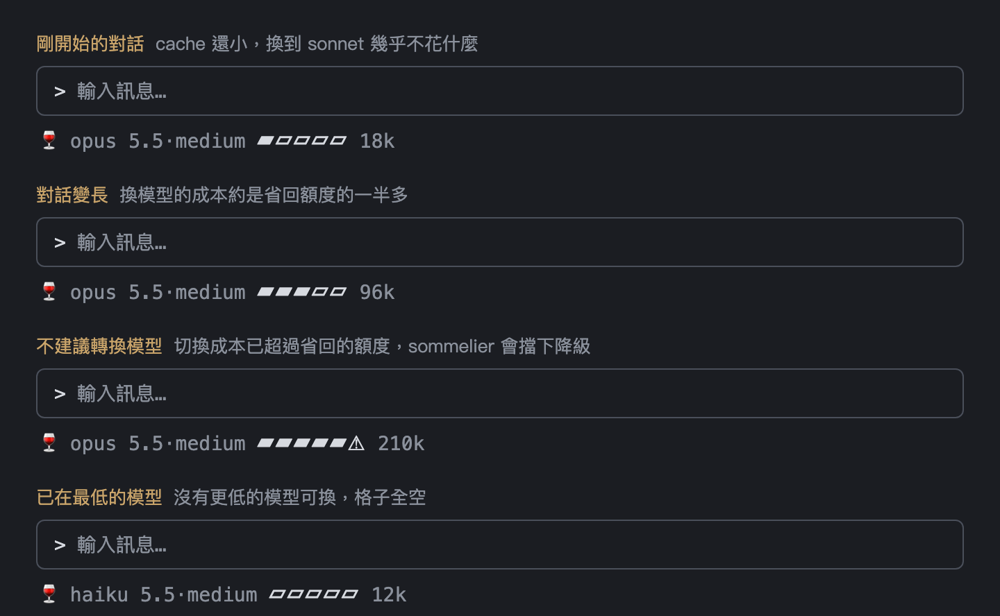

<p align="center">
  
</p>

[English](README.md) | 繁體中文 | [简体中文](README.zh-CN.md) | [日本語](README.ja.md) | [한국어](README.ko.md)

[](https://ko-fi.com/Y8H028VWRF)

# sommelier：Claude Code 自動選模型的 plugin（Claude Code mods）

依任務替 Claude Code 自動挑選「模型 · effort」的 plugin，用 **Claude Code mods**（mods API 的 `turn.step`）實作。簡單的請求交給 **Claude Haiku**，明確的實作交給 **Claude Sonnet**，需要調查或設計的交給 **Claude Opus**，用 **TypeSafe Jev** 分類請求，在不犧牲品質的前提下節省 Claude Code 的用量與額度。

就像侍酒師依菜色挑酒，sommelier 在你送出每個新請求時，請 [TypeSafe Jev](https://docs.typesafe.ai)（一個回傳機率的分類 API）判斷三件事：**需要多深的推理**、**是不是新話題**、**是不是高風險操作**，再對應到一張可調整的階梯表：

| 推理深度 | 預設檔位 | 例子 |
|---|---|---|
| L0 查詢或機械性修改 | haiku · medium | 「看一下 package.json 的 version」 |
| L1 目標和做法都明確 | sonnet · medium | 「幫 parseDate 加上時區參數」 |
| L2 要先調查或取捨 | `base`（opus · medium） | 「登入偶爾 401，找出原因」 |
| L3 沒有明確邊界、需要長時間推演 | opus · high | 「設計多租戶權限架構」 |

**為什麼不每輪都換模型？** 每個模型各有一份 prompt cache，換模型就要把整段對話重新寫入 cache，同樣消耗額度。所以 sommelier 的原則是：**往上升隨時可以；往下降只在划算時才做**，也就是新話題、而且切換成本低於能省下的額度時。

## 快速開始

```bash
claude plugin marketplace add wide3751/sommelier
claude plugin install sommelier@sommelier
# 執行下一行後貼上你的 TypeSafe API key，按 Enter（畫面不會顯示 key）
read -rs TYPESAFE_API_KEY
# 把 key 存進 macOS Keychain
printf '{"typesafe_api_key":"%s"}' "$TYPESAFE_API_KEY" | claude plugin configure sommelier@sommelier --values-stdin
```

API key 到 [TypeSafe console](https://console.typesafe.ai/keys) 建立。如果已經在 `~/.zshrc` 設好 `TYPESAFE_API_KEY`，可以跳過 `read` 那行。

重新啟動 Claude Code 就會自動開啟，不用另外設定：

1. 送出一個請求，例如「幫 parseDate 加上時區參數」
2. spinner 會顯示選到的檔位，例如 `sonnet·medium L1 · 新話題，降級`

不想用了就輸入 `/somm off`。詳細步驟見[安裝](#安裝)與[使用](#使用)。

## 讓 AI agent 幫你安裝

先準備好 TypeSafe API key。key 不要交給 agent，自己設定成環境變數：

1. 到 [TypeSafe console](https://console.typesafe.ai/keys) 建立 API key
2. 在終端機執行下面這行，把 `your-api-key` 換成你的 key，寫進 `~/.zshrc`：

   ```bash
   echo 'export TYPESAFE_API_KEY="your-api-key"' >> ~/.zshrc
   ```

3. 重新開啟終端機和 Claude Code，讓新的環境變數生效

設定好之後，把這句話貼給 Claude Code 或其他 coding agent：

> 照 https://github.com/wide3751/sommelier/blob/main/INSTALL-AGENT.md 安裝 sommelier

## 需求

- Claude Code **v2.1.287 以上**（終端機），或 Desktop app 內建版本 **v2.1.286 以上**（在 Code tab 輸入 `/status` 查看）
- TypeSafe API key（到 [TypeSafe console](https://console.typesafe.ai/keys) 建立）

## 安裝

1. 加入 marketplace 並安裝。有兩種方式，**建議用 GitHub**：

   **方式 A：從 GitHub 安裝（建議）**，不用下載專案：

```bash
claude plugin marketplace add wide3751/sommelier
claude plugin install sommelier@sommelier
```

   之後要更新到新版本，先更新 marketplace，再更新插件，然後重開 Claude Code（已經裝過時再跑 `install` 不會升級）：

```bash
claude plugin marketplace update sommelier
claude plugin update sommelier@sommelier
```

   **方式 B：從本機資料夾安裝**，適合已經 clone 專案、想裝自己改過的版本：

```bash
git clone https://github.com/wide3751/sommelier.git ~/Projects/sommelier
claude plugin marketplace add ~/Projects/sommelier
claude plugin install sommelier@sommelier
```

2. 設定 TypeSafe API key（存進 macOS Keychain）。終端機版可以在 session 裡執行 `/plugin configure sommelier@sommelier`；Desktop app 的 Code tab 不會跳出輸入框，請改在終端機執行：

```bash
# 執行下一行後貼上你的 TypeSafe API key，按 Enter（畫面不會顯示 key）
read -rs TYPESAFE_API_KEY
# 把 key 存進 macOS Keychain
printf '{"typesafe_api_key":"%s"}' "$TYPESAFE_API_KEY" | claude plugin configure sommelier@sommelier --values-stdin
```

   key 不用寫進指令裡：`read` 會等你貼上，存在這個終端機的 `TYPESAFE_API_KEY` 變數，下一行再把它存進 Keychain，所以 key 不會留在 shell 歷史紀錄。已經在 `~/.zshrc` 設好 `TYPESAFE_API_KEY` 的話，可以跳過 `read` 那行，但要確認目前的 shell 讀得到它（例如新開一個終端機視窗）。也可以只設定環境變數 `TYPESAFE_API_KEY` 當作備援，但從 Dock 開啟的 Desktop app 讀不到 `~/.zshrc`。

### Windows 安裝

步驟 1（加入 marketplace 並安裝）的指令在 PowerShell 一樣能用。本機資料夾的方式把路徑換成 Windows 路徑，例如 `claude plugin marketplace add C:\Projects\sommelier`。

步驟 2 的 `read -rs` 在 PowerShell 沒有，改用下面這段，在 PowerShell 執行（Windows PowerShell 5.1 與 PowerShell 7 都能用）：

```powershell
# 執行下一行後貼上你的 TypeSafe API key，按 Enter（畫面不會顯示 key）
$s = Read-Host "TypeSafe API key" -AsSecureString
$key = [System.Net.NetworkCredential]::new("", $s).Password
# 交給 Claude Code 存成 plugin 設定
'{"typesafe_api_key":"' + $key + '"}' | claude plugin configure sommelier@sommelier --values-stdin
Remove-Variable key, s
```

Keychain 只有 macOS 才有；Windows 上 key 由 Claude Code 的 plugin 設定保存。想改用環境變數當備援，把 key 永久寫進使用者環境變數（把 `your-api-key` 換成你的 key），再重新開啟終端機和 Claude Code：

```powershell
[Environment]::SetEnvironmentVariable("TYPESAFE_API_KEY", "your-api-key", "User")
```

3. 重新啟動 Claude Code，輸入 `/somm status`，確認顯示「API key 已設定」。

## 使用

安裝後預設**開啟**，不用另外輸入 `/somm on`。第一次要把請求送給 TypeSafe 之前，會先跳出確認：同意後就不再詢問；不同意的話，這一輪沿用原本的模型，並關閉 sommelier。

| 指令 | 說明 |
|---|---|
| `/somm on` | 重新開啟。之後你送出的每個請求都會交給 Jev 判斷（短回覆除外） |
| `/somm off` | 關閉，沿用 session 自己的模型與 effort |
| `/somm off --project` | 只在目前的專案停用，這個專案的內容不會送出；`/somm on --project` 恢復 |
| `/somm status` | 顯示開關、此專案是否停用、API key 是否設定、本 session 的檔位 |
| `/somm log [n]` | 最近 n 筆分派紀錄：選了哪個檔位、Jev 的機率、cache 讀寫量 |
| `/somm events` | 最近 20 筆狀態事件（換模型、清除或恢復對話、prompt 來源、每輪的分派結果），用來排查 sommelier 為什麼沒換模型 |
| `/somm config` | 列出目前的設定；`/somm config <名稱> <值>` 修改，立即生效 |

**設定**（`/somm config <名稱> <值>`）：

| 名稱 | 預設 | 可用的值 |
|---|---|---|
| `enabled` | on | on／off，等同 `/somm on`、`/somm off` |
| `base` | opus | 需要調查或比較的請求（L2）用的檔位，也是高風險請求的最低模型。`haiku`／`sonnet`／`opus`，可加 effort，例如 `opus:high` |
| `profile` | balanced | `saver`（省額度：較少用 opus、較晚換話題）、`balanced`（平衡）、`quality`（品質優先：較早用 sonnet／opus、haiku 只接 15k 以內的對話）；也可以寫中文名稱 |
| `allowed` | haiku-opus | sommelier 可以選的模型範圍，例如 `sonnet-opus` 就不會用 haiku。`somm:` 覆寫不受限制 |
| `spinner` | on | Claude 工作時 spinner 旁是否顯示這一輪的判斷 |
| `cache` | on | 狀態列是否顯示 cache 量表；`off` 時只顯示模型與 effort |
| `notify` | important | 跳出重要提示：覆寫或降級要重寫 cache、Jev 連續 3 次判斷失敗、沒有 API key（只提示一次）。同一輪最多一則，10 秒內有好幾則時只補顯示最新的一則；`off` 不跳提示 |
| `skills` | off | skill 提示的開關（beta，預設關閉）。`on` 開啟；`off` 只關掉 skill 提示，選模型照常運作 |
| `skills-allow` | （全部） | 只讓這些 skill 成為候選，逗號分隔，名稱照 `/skills` 列出的寫，例如 `mattpocock-skills:tdd,grilling`；`none` 清空 |
| `skills-exclude` | （無） | 不提示這些 skill，寫法同上；跟 `skills-allow` 都列了的以排除為準 |

開啟後，prompt 下方的狀態列會顯示實際回答的模型、版本與 effort，後面接著 cache 量表，例如 `🍷 opus 5.5·medium ▰▰▱▱▱ 95k`。旁邊 Claude Code 自己顯示的是 session 的模型。

**cache 量表**：數字是目前模型累積的 cache 量。5 格代表換到 allowed 範圍內下一個較低模型的切換成本（重寫 cache 的費用），佔預估省回額度的多少，每格 20%。格子越滿，換下去越不划算；滿格再加上 `⚠`（例如 `▰▰▰▰▰⚠ 243k`）表示切換成本已經超過省回的額度，sommelier 這時會擋下降級，你自己換也不建議。cache 已過期、或已經是 allowed 內最低的模型時，格子全空。狀態列不能上色，所以用滿格加 `⚠` 當警示。嫌擠可以用 `/somm config cache off` 關掉。



<sub>示意圖：剛開始的對話、對話變長、不建議轉換模型、已在最低的模型。</sub>

`/somm` 如果被其他 plugin 占用，會自動改用 `/sommelier`。

**自己指定模型（覆寫）**：在 prompt 開頭寫 `somm:opus`、`somm:sonnet` 或 `somm:haiku`（不分大小寫），這一句就用指定的模型（effort medium），不送 Jev。前綴會先拿掉，模型看不到。之後同一個話題都沿用這個模型，直到 Jev 判斷出新話題、`/clear` 或你用 `/model` 換模型為止。只寫前綴、不寫內容時不會送出任何東西，只設定接下來要用的模型。換模型要重寫 cache 時，會跳出提示說明要重寫多少 token、大約多少錢。

**每個請求怎麼決定：**
- **升級**：判斷需要較強的模型或較高的 effort 時，隨時往上換
- **高風險**：會刪除或覆寫資料、改正式環境或權限的請求，模型至少換到 base（預設 opus），這一句 effort 提高為 high，下一句恢復原本的 effort
- **要求深入思考**：prompt 裡有 `ultrathink`、「仔細想」或「深入想」（程式碼區塊內不算）時直接用 opus · high，不送 Jev
- **降級**：只在新話題、而且預估省下的額度大於重寫 cache 的成本時才往下換；否則這一句沿用目前的模型
- **沿用**：同一個話題判斷較低時、短回覆（例如「好」「繼續」，不送 Jev）、Jev 逾時或回傳錯誤時，維持目前的模型
- **對話太長不用 haiku**：對話超過 30k tokens 時不會降到 haiku；已經在 haiku 上的對話長到超過這個長度，會改用 sonnet

**skill 提示**（beta，預設關閉，用 `/somm config skills on` 開啟）：判斷模型的同時，Jev 也會判斷這一句需不需要某個 skill、最適合哪一個。夠有把握時（「需要 skill」≥ 0.30，而且第一名 ≥ 0.5），sommelier 會在這一句旁邊附一段提示給 Claude，例如「這個請求可能適合 skill『tdd』（可能有誤）」。這只是建議，Claude 判斷不適用就會忽略；提示不影響模型。候選是這個 session 裡 Claude 能自己呼叫、而且有描述的 skill，可以用 `skills-allow`、`skills-exclude` 縮小。同一個話題裡同一個 skill 只提示一次，換話題或 `/clear` 後才會再提示。有提示時 spinner 會顯示 `💡tdd`，`/somm log` 會記下 Claude 有沒有採用。開啟 skill 提示時，因為要等 Jev 判斷完才能附上提示，送出 prompt 後會先等 Jev（最多 1.5 秒）。

### 能選的模型與 skill

**模型**：sommelier 只會在下面三個模型之間挑選，effort 只用 medium 或 high。

| 模型 | 送出的模型 ID | sommelier 何時選它 |
|---|---|---|
| haiku | `claude-haiku-5-5` | L0；對話超過 30k tokens 時不用 |
| sonnet | `claude-sonnet-5-5` | L1；haiku 的對話變長時也改用它 |
| opus | `claude-opus-5-5` | L2（base，medium）、L3、要求深入思考（high）；高風險請求至少用 base |

帶日期後綴的 ID（例如 `claude-sonnet-5-5-20261001`）也認得。要改變能選的範圍：

- **縮小範圍**：`/somm config allowed sonnet-opus` 就不會用 haiku；`opus-opus` 等於只用 opus
- **換 L2 的檔位**：`/somm config base sonnet` 或 `opus:high`，任一模型都可以加 medium／high，但要在 `allowed` 範圍內
- **這個話題指定模型**：prompt 開頭寫 `somm:haiku`、`somm:sonnet`、`somm:opus`（effort 固定 medium，不受 `allowed` 限制）
- **完全自己決定**：用 `/model` 換 session 的模型，sommelier 在你換回 Default 之前都不改動模型

**skill**（skill 提示開啟時）：能被提示的候選 skill 由這個 session 決定，不需要另外登記。

- **哪些會成為候選**：Claude 能自己呼叫、而且有描述的 skill，也就是 `/skills` 列出、沒有被設成只能手動呼叫的那些。plugin 的 skill 寫成 `plugin名:skill名`，例如 `mattpocock-skills:tdd`
- **數量**：依名稱排序，最多 255 個，超過的略過；少於 2 個時不會問 Jev skill 的題目
- **只提示某幾個**：`/somm config skills-allow mattpocock-skills:tdd,grilling`；`none` 清空，恢復全部
- **排除某幾個**：`/somm config skills-exclude cost-today`；同時出現在兩份清單時以排除為準
- **確認效果**：`/somm log` 會記下每一句提示了哪個 skill、Claude 有沒有採用

**以下情況 sommelier 不會改動模型：**
- 關閉時，或目前專案已停用
- 第一次送出前的確認沒有同意
- session 的第一句 Jev 就失敗，或沒有設定 API key（之後的句子失敗則沿用目前的模型）
- subagent 的請求

### 範例

開啟後送出「幫 parseDate 加上時區參數」，Jev 判斷為 L1，從 session 的 opus 降到 sonnet，spinner 會顯示：

```
sonnet·medium L1 · 新話題，降級
```

接著回「好」，短回覆不送 Jev，沿用同一個檔位：

```
sonnet·medium · 沿用
```

再要求「設計多租戶權限架構」，Jev 判斷為 L3，升級：

```
opus·high L3 · 升級
```

`/somm status`：

```
sommelier 開啟｜API key 已設定｜本 session 檔位 sonnet·medium
```

`/somm log 3`：P 是 Jev 判斷為 L0／L1／L2／L3 的機率；`session` 表示這一輪用 session 自己的模型；「回答」是實際回答的模型，方括號是 session 的前六碼：

```
sonnet·medium · 回答 sonnet · downgrade P=0.05/0.90/0.05/0.00 jev 820ms cache read 0 write 18342 [a1b2c3]
sonnet·medium · 回答 sonnet · continuation cache read 18342 write 1204 [a1b2c3]
opus·high · 回答 opus · upgrade P=0.02/0.08/0.20/0.70 jev 410ms cache read 0 write 21530 [a1b2c3]
```

## 限制

- **手動 `/model`**：用 `/model` 換模型之後，sommelier 就不再改模型，`/clear` 和恢復對話之後也一樣，直到你在 `/model` 選回 Default。Claude Code 自動 fallback 到其他模型之後也會停手，直到你手動 `/model`。
- **不判斷的輪**：通知、排程、其他 session 或其他 plugin 送來的訊息，以及 slash 指令，都沿用目前的模型，不送給 Jev。session 模型不是 Opus／Sonnet／Haiku 5.5（例如 `[1m]` 版本或舊版）時，sommelier 不做任何改變。
- **不划算就不降級**：每個模型各有一份 cache，換模型要把對話寫進新模型的 cache。sommelier 會記下每個模型的 cache 涵蓋到哪裡：切到從沒用過、或閒置超過 cache 時效的模型要整段重寫；切回剛用過的模型只補差額；`/clear`、compact、resume 之後只剩系統提示還在 cache 裡。往下降時比較「重寫成本」和「預估 3 輪能省回的錢」，省不回來就這一句沿用原模型，下一個新話題再重新評估。往上升不受影響。價格用的是官方定價，寫在 `hooks/decide.ts`。
- **模型選單顯示的是 session 模型**：sommelier 改的是每個送出的請求，不改 session 本身的模型，所以 `/model` 和 Desktop 的模型選單一直顯示原本的模型。實際回答的模型看狀態列 🍷 後面的模型。
- **Jev 判斷要時間**：每個請求的判斷最多等 1.5 秒（離線評測 p95 約 0.4 秒），短回覆不送 Jev、不用等。
- **Desktop app**：Code tab 不能用 `/plugin configure` 輸入 API key，要改在終端機設定（見「安裝」）。

## 疑難排解

| 症狀 | 做法 |
|---|---|
| `/somm status` 顯示「API key 未設定」 | 照「安裝」第 2 步重新設定。只靠環境變數的話，確認啟動 Claude Code 的 shell 讀得到 `TYPESAFE_API_KEY`；從 Dock 開啟的 Desktop app 讀不到 `~/.zshrc` |
| spinner 顯示「Jev 失敗」 | 用 `/somm log` 看原因：`no_key` 是沒有 key，`timeout` 是超過 1.5 秒，`http_401` 等是 API 回傳錯誤，`fetch_failed` 是連不上 TypeSafe。這一輪沿用目前的模型；session 第一句就失敗時用 session 自己的模型 |
| `/somm` 指令不見了 | 被其他 plugin 占用，改用 `/sommelier` |
| 改了程式碼沒有生效 | 正式安裝版依 `plugin.json` 的 `version` 快取。版本號加一後執行 `claude plugin update sommelier@sommelier` 並重開，或開發時改用 `--plugin-dir` |

## 隱私與資料

sommelier 安裝後預設開啟，開啟時會把資料送到 TypeSafe 判斷。第一次送出前會先詢問你是否同意；用 `/somm off` 關閉後就不會送出任何東西。

- **什麼時候送**：每個新請求都會送出；短回覆（去掉空白標點後 8 字以內，例如「好」「繼續」）不送
- **送出什麼**：這一句請求（最多 2000 字），以及最近 3 輪對話的文字（每則最多 500 字，只保留結尾）；開啟 skill 提示時，另外送出候選 skill 的名稱與描述（每則最多 300 字）。第一次使用時的確認不包含 skill；開啟 skill 提示後，第一次送出 skill 資料前會另外確認一次，不同意只會關掉 skill 提示
- **送出前遮蔽**：常見的密鑰格式會換成 `[REDACTED]`，包括 `sk-`、`AKIA`、`ghp_`、`xoxb-`／`xoxp-`、`AIza`、`Bearer`、`password=`、JWT、私鑰區塊，以及 32 字以上的十六進位字串
- **不送什麼**：檔案內容、工具呼叫與工具輸出、subagent 的請求，以及用 `/somm off --project` 停用的專案
- **本機紀錄**：`/somm log` 的紀錄存檔位、Jev 的機率、延遲、cache 讀寫量、提示的 skill 與有沒有採用，以及 prompt 的前 40 字（遮蔽後）；停用的專案不存 prompt。另外每個 session 的分派狀態（目前檔位、cache 帳、覆寫鎖定等，不含 prompt）也存在本機，讓更新 plugin 後執行中的 session 能接續；只保留最近 20 個 session
- **API key**：存在 macOS Keychain（`/plugin configure`），或從環境變數 `TYPESAFE_API_KEY` 讀取

## 參與開發

開發環境、離線評測與專案結構見 [CONTRIBUTING.md](CONTRIBUTING.md)。

## 文件

- [GLOSSARY.md](GLOSSARY.md)：用語定義（檔位、新話題、cache 帳…）

## 授權

[MIT](LICENSE)
